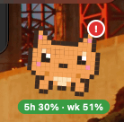
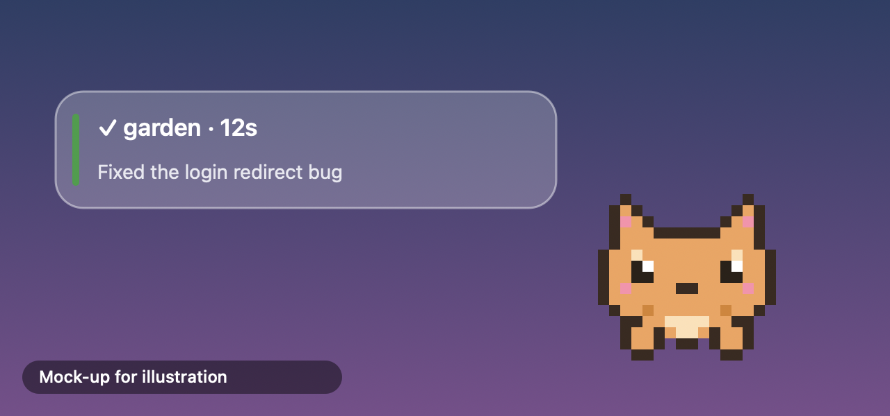
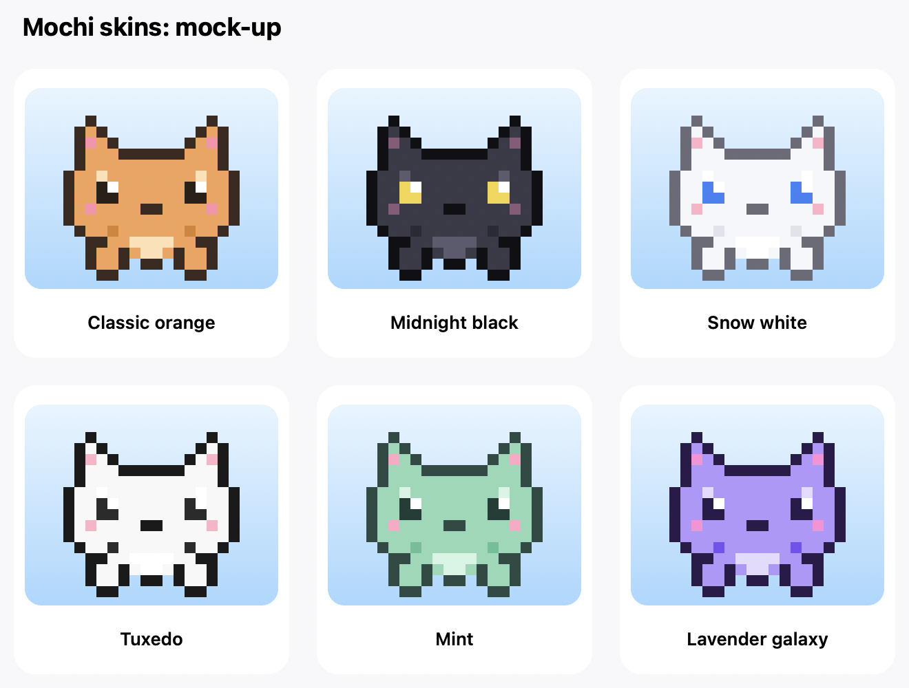
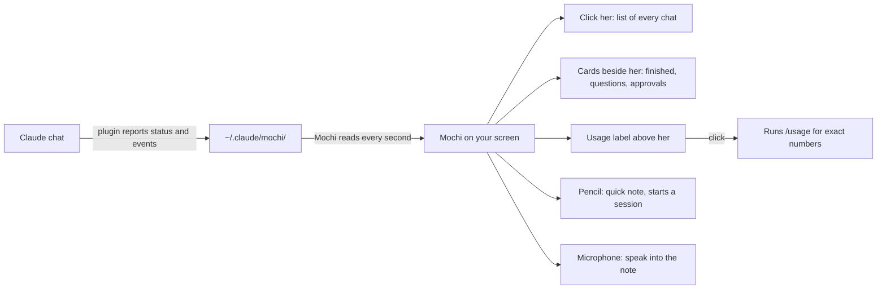

# Mochi

> **Work in progress.** Mochi works day to day, but parts are still changing, and some things may break. Feedback and issues are welcome.

  

Mochi is a pixel-art companion for [Claude Code](https://claude.com/claude-code) on macOS. She sits above your message box, floats on your desktop, and keeps you informed about every chat without you having to watch them.

## Features

- **Status at a glance.** Working, needs your OK, ready, or blocked, shown by her pose, her badge, and her colours.
- **Her mood follows your limit.** Past 70% of either limit her eyes get a lid, so she looks tired.
- **Notifications beside her.** Finished work, questions, and tool approvals appear as Liquid Glass cards next to her. A sound plays when a chat needs you.
- **Allow or deny from her.** When a chat asks for your OK, her card has Allow and Deny buttons, so you can answer without switching to Claude. Claude gives her about 8 seconds to answer before its normal prompt appears, so click quickly. Turn this off in her right-click menu, and the normal prompt shows at once.
- **Every chat in one list.** Click her to see all your recent chats and their latest news. Click a line to open that chat in Claude.
- **Plan usage.** A label above her shows your 5-hour and weekly limits. Clicking it asks Claude for the exact numbers, the same as `/usage`, and shows when you can continue after you run out.
- **Quick note.** A pencil button under her opens a small box. Press Enter to start a new Claude Code session with your note.
- **Talk.** A microphone button under her types what you say into the same box, using your Mac's speech recognition. Nothing is sent until you press Enter.
- **Shortcuts from any app.** Control-Option-N opens a quick note, and Control-Option-M starts talking, even when Mochi is not in front.
- **Jump to the chat that needs you.** Control-Option-J, or a click on her red badge, opens the chat that has waited longest for your OK.
- **A colour for each chat.** Every chat has its own coloured dot on its cards and its line in the list, so you can tell chats apart at a glance.
- **Tidy by herself.** Status files from chats untouched for a week are deleted at launch and every hour, so she stays quick.
- **Skins.** Six looks, chosen from her right-click menu under **Skin**.
- **Mochi Studio.** A small app to change her body, eyes, accessory and name, with a live preview. It saves to the same file Mochi reads, opens with the look you saved, and previews her in the skin chosen in Mochi's menu, drawn the way Mochi draws it. Undo and redo (⌘Z and ⇧⌘Z) step back through every change.

  

  

## How it works

| Mochi | Meaning |
| --- | --- |
| Walking, dots on her badge | Claude is working |
| Red clock, sound | Claude needs your OK or has a question |
| Hopping, green check | Claude has finished; she stays "ready" until your next message |
| Grey, squinting | A reply was interrupted or failed |

The project has two parts:

| Part | What it is |
| --- | --- |
| `pet-mod/` | A Claude Code plugin. It reports what each chat is doing. |
| `mochi-desktop/` | A macOS app that shows Mochi on your screen. |
| `mochi-studio/` | A macOS app for customising how Mochi looks. |

## About Claude Code mods

Mochi is built as a **mod** for Claude Code. A mod is a small TypeScript plugin that runs inside Claude Code and reacts to events, such as a chat finishing or a tool asking for approval. According to a [report from IT-Connect](https://www.it-connect.fr/claude-code-mods-plugins/), Anthropic announced mods on 1 October 2026, and they are enabled by default from Claude Code 2.1.287. That date comes from a single source, so check it against Anthropic's own documentation. Plugins, a related feature, were announced on [9 October 2025](https://anthropic.com/news/claude-code-plugins).

## Requirements

- macOS 13 or later. The Liquid Glass look needs macOS 26; earlier versions use a frosted style.
- Claude Code 2.1 or later, with the Claude desktop app.
- Xcode command line tools (`xcode-select --install`), to build the app.

## Installation

The simplest way is to open Claude Code and say:

> Follow CLAUDE-SETUP.md in this folder to set up Mochi.

To install by hand, follow the steps in [CLAUDE-SETUP.md](CLAUDE-SETUP.md).

## Privacy

- Mochi reads and writes files only in `~/.claude/mochi/` and in the Claude app's own folders.
- Mochi's own code makes no network requests.
- The usage check runs the copy of Claude that comes with the app. That copy contacts Anthropic's servers to read your usage, the same way `/usage` does. Nothing is sent that you haven't already sent through Claude.

## Background

Claude didn't have a pet, so I made one for myself. I wanted a companion that lives alongside my work: one that tells me when things finish, asks for my attention when a chat needs me, and shows how much of my limit is left, without my having to watch every chat.

### History

1. **A text pet in the side panel.** A small character with a status line, drawn with Claude Code's plugin system.
2. **A pet that walks.** It moved while Claude worked, and reacted when work finished or was blocked.
3. **A strip above the message box.** It moved out of the side panel, so it no longer took up space.
4. **Pixel art.** A 16×16 pixel cat with a status badge, later with a blinking, animated look.
5. **A floating app.** Mochi became her own small window that you can drag anywhere, with a list of every chat.
6. **Notification cards.** Finished work, questions, and approvals appear beside her as Liquid Glass cards that open their chat when clicked.
7. **Plan usage.** A label showing your 5-hour and weekly limits, and when you can continue.
8. **Skins.** Six looks to choose from.
9. **Mochi Studio.** A preview app for designing Mochi's look.
10. **Quick note and talk.** Two buttons under Mochi: type a note or speak it, and start a session with it.
11. **Allow or deny from Mochi, shortcuts, and undo.** Answer a chat's request from her card, open the note or talk from any app, and undo your painting in Mochi Studio.
12. **Jump, colours, and tidying.** A shortcut and badge click to reach the chat waiting for you, a colour dot for each chat, and old status files cleaned up.

## Roadmap

- Clean screenshots of the notification cards, usage panel, and quick note
- Sign and notarise the desktop app so it opens without warnings
- Support for Claude chats outside Claude Code

## Licence

MIT. See [LICENSE](LICENSE).
