# Mochi

<p align="center">
  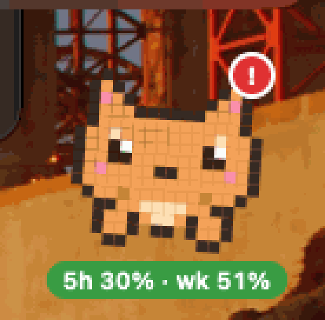
</p>

<p align="center">
  <b>A pixel-art companion for <a href="https://claude.com/claude-code">Claude Code</a> on macOS.</b><br>
  She floats above your message box and tells you what every chat is doing, so you don't have to watch them.
</p>

<p align="center">
  
  
  
  
</p>

> **Work in progress.** Mochi works day to day, but parts are still changing, and some things may break. Feedback and issues are welcome.

<p align="center">
  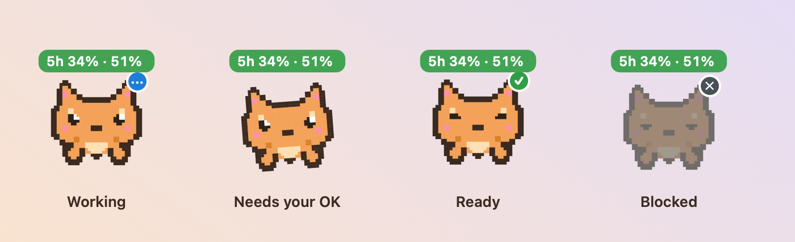
</p>

**On this page:** [Quick start](#quick-start) · [What she does](#what-she-does) · [Shortcuts](#shortcuts) · [How it works](#how-it-works) · [Development](#development) · [Privacy](#privacy) · [Roadmap](#roadmap)

## Quick start

1. Install the Xcode command line tools: `xcode-select --install`. Mochi builds from source, so this is required.
2. Download this repository, open Claude Code in the folder, and say: *Follow CLAUDE-SETUP.md in this folder to set up Mochi.*
3. Mochi appears in the bottom-right corner of the screen. Allow notifications when macOS asks.

**Requirements:** macOS 13 or later (the Liquid Glass look needs macOS 26; earlier versions use a frosted style), Claude Code 2.1 or later with the Claude desktop app, and the Xcode command line tools. The app is not notarised yet, so macOS may show a warning the first time you open it.

<details>
<summary>Install by hand</summary>

The full steps, with checks, are in [CLAUDE-SETUP.md](CLAUDE-SETUP.md). In short:

```sh
# 1. Build the app where the plugin expects to find it
mkdir -p "$HOME/Documents/Claude Mods/Mochi Desktop"
cp -R mochi-desktop/. "$HOME/Documents/Claude Mods/Mochi Desktop/"
(cd "$HOME/Documents/Claude Mods/Mochi Desktop" && sh build.sh)
open "$HOME/Documents/Claude Mods/Mochi Desktop/Mochi.app"
```

```text
# 2. In a Claude Code chat, install the plugin (choose the user scope)
/plugin marketplace add <path to this folder>
/plugin install pet-mod@mochi
```

Then start a new chat and send a message. Mochi should show "Working", then "Ready".

</details>

## What she does

> The images below are drawn by the app's own views with made-up chats, not captured from a screen, so no real chat names appear. Liquid Glass can't be drawn off screen, so a frosted panel stands in for it. See [Development](#development) to regenerate them.

### She shows what each chat is doing

Her pose, her badge, and her colours tell you the state of your chats at a glance.

| Mochi | Meaning |
| --- | --- |
| Walking, dots on her badge | Claude is working |
| Wiggling, sound | Claude needs your OK or has a question |
| Hopping, green check | Claude has finished; she stays "ready" until your next message |
| Grey, squinting | A reply was interrupted or failed |

**Her mood follows your limit.** Past 70% of either limit her eyes get a lid, so she looks tired. With less than an hour left in the 5-hour window, a countdown sits on the right end of the usage bar. It is orange, then red in the last 30 minutes.

<p align="center">
  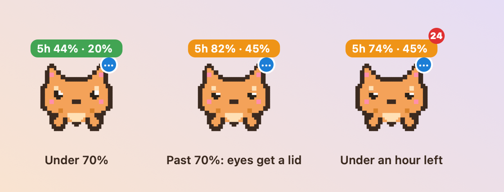
</p>

### You can answer from her card

When a chat asks for your OK, her card has **Allow** and **Deny** buttons, so you can answer without switching to Claude. It is laid out like Claude's own permission dialog: the question, the whole command or path in a box, and Deny and Allow once with their keys. The mode keys are listed only in chats that can switch modes.

Claude gives her about 8 seconds to answer before its normal prompt appears, so click quickly. Requests that only read or search files, or run read-only commands like `ls` or `git status`, never show a card; Claude still asks you in its own window. Turn the card off in her right-click menu, and the normal prompt shows at once.

<p align="center">
  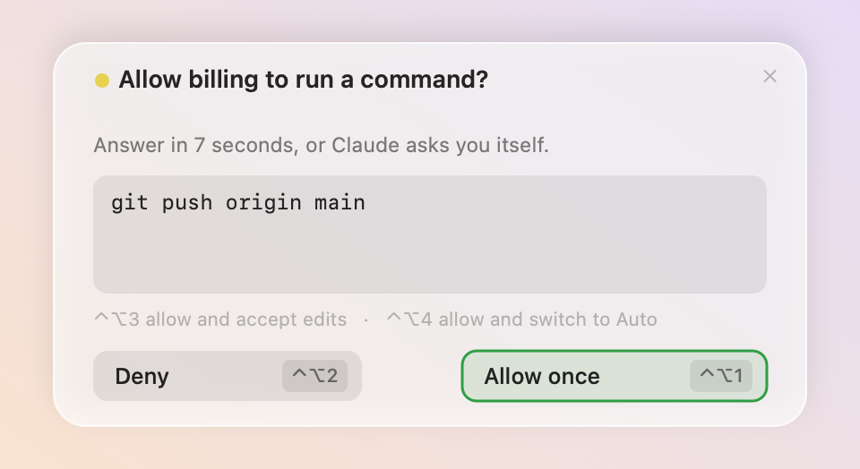
</p>

By default she only pops up for a chat that needs your OK. Finished work, usage warnings and her thoughts go to her list, not to a card or sound. Turn on everything from her right-click menu.

<p align="center">
  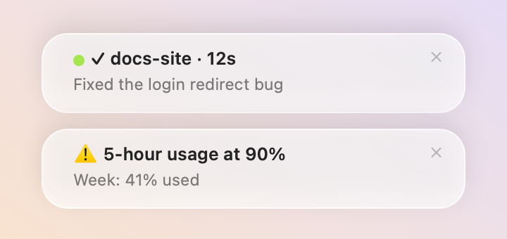
</p>

### Every chat in one list

Click her to see your recent chats in boxes, grouped by what they are doing.

- **Running now** is always at the top, with the chats that are working right now.
- **Waiting** chats follow, with Allow and Deny under each one.
- **Finished** shows the latest ten, and **Resting** holds the rest.
- The list updates as chats change, and the heading counts the chats waiting for you. Click a box to open that chat in Claude.
- Every chat has its own coloured dot on its cards and its line in the list, so you can tell chats apart at a glance.
- Option-J, or a click on her red badge, opens the chat that has waited longest for your OK.

<p align="center">
  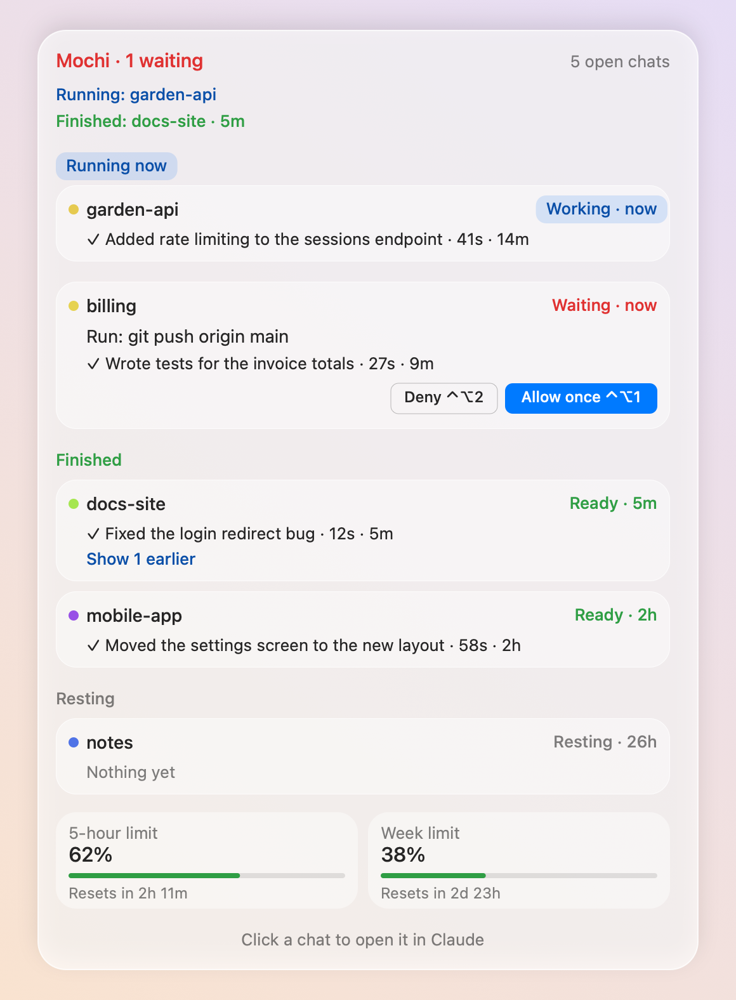
</p>

### Plan usage

A label above her shows your 5-hour and weekly limits. Clicking it opens a box with the state (on track, getting high, almost out, or out of usage), both limits as bars, and when each one resets. **Refresh** asks Claude for the exact numbers, the same as `/usage`. If you are out of usage, the box shows when you can continue.

<p align="center">
  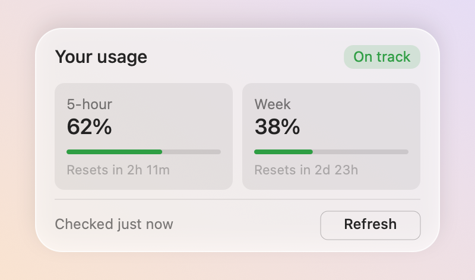
</p>

### Quick note and talk

Three round buttons appear under her when you move the pointer near her.

- **Pencil:** opens a small box. Press Enter to start a new Claude Code session with your note.
- **Microphone:** types what you say into the same box, using your Mac's speech recognition. Nothing is sent until you press Enter. The button turns red while she listens.
- **Scroll:** opens [her week and diary](#her-week-and-diary).

While a live chat is in **Auto** mode (a model decides which requests to approve), gold sparkles appear around her. They go away when the mode changes.

<p align="center">
  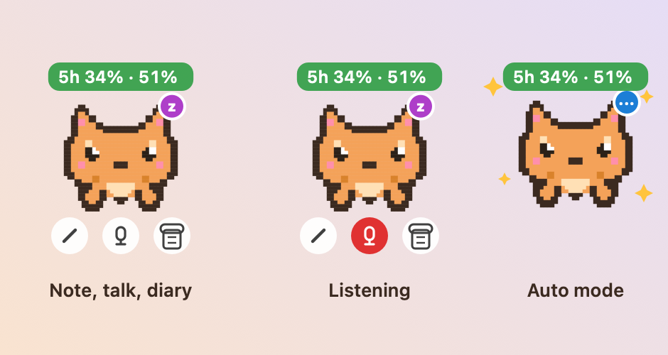
</p>

### Her week and diary

The scroll button opens two tabs. **This week** shows the week's turns and approvals each day, that day's peak 5-hour usage, the most active chats, and your week limit. **Diary** shows twelve weeks as squares, the darker the busier, with the busiest day, active days and your streak. Mochi keeps a small daily count in `~/.claude/mochi/days.json`, with no chat content.

<p align="center">
  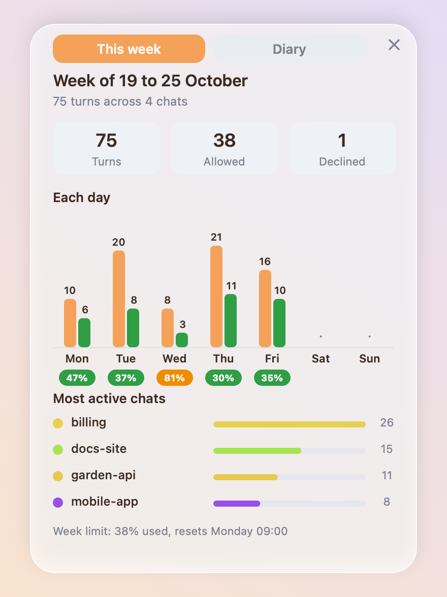
  &nbsp;
  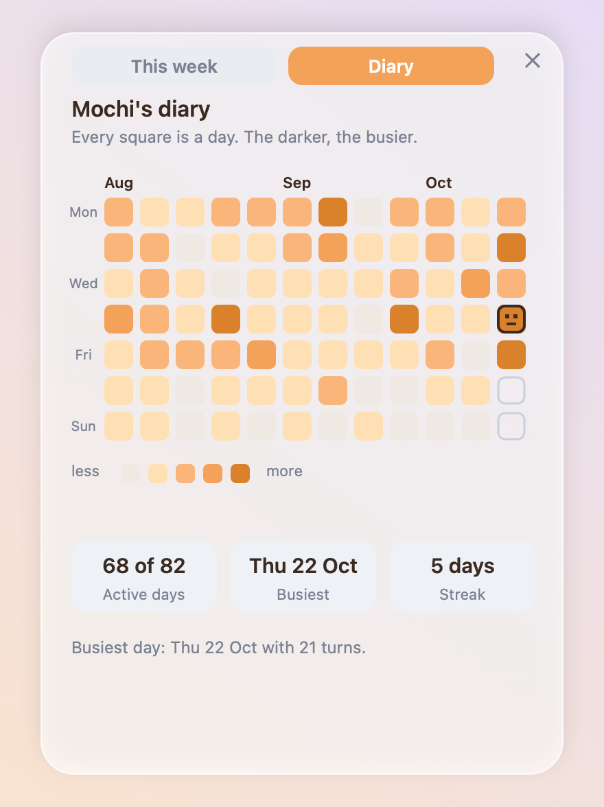
</p>

### Little thoughts

Now and then she thinks out loud in a bubble above her: how long is left in her 5-hour window, a warning near the limit, chats that are ready, or a fun fact. One at a time, only when nothing needs you, and she stays quiet when you ask her to.

<p align="center">
  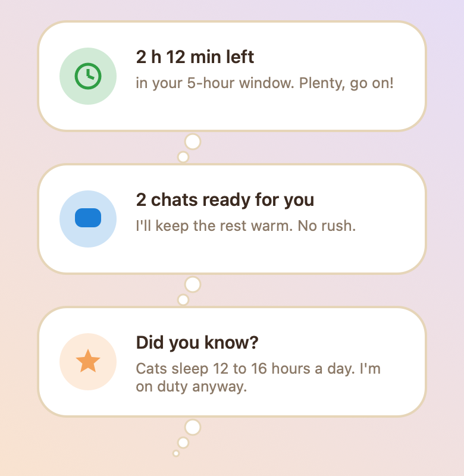
</p>

### Quiet, and tidy

- **Quiet for 1 hour**, or **Quiet until I turn sounds back on**, from her right-click menu, silences her sounds, and the cards and Mac notifications for finished work. Questions and approval cards still show, and the same item ends the quiet early.
- She tidies up after herself: status files from chats untouched for a week, and answer files untouched for two weeks, are deleted at launch and every hour, so she stays quick.

### Make her yours

Six skins, chosen from her right-click menu under **Skin**.

<p align="center">
  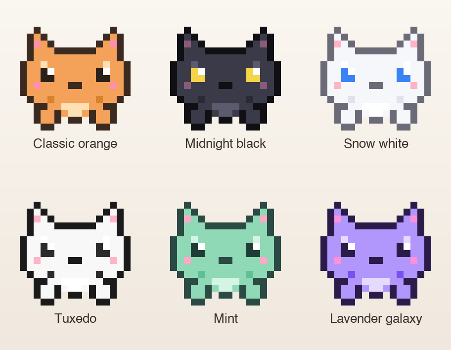
</p>

**Mochi Studio** is a small app to change her body, eyes, accessory (none, bow, hat, or scarf), and name, with a live preview. It saves to the same file Mochi reads, opens with the look you saved, and previews her in the skin chosen in Mochi's menu, drawn the way Mochi draws it. Undo and redo (⌘Z and ⇧⌘Z) step back through every change.

<p align="center">
  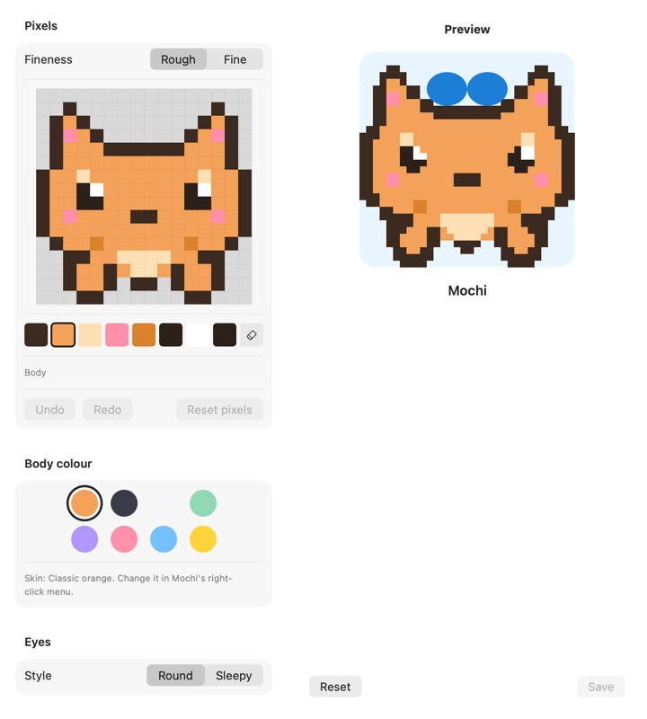
</p>

## Shortcuts

These work from any app, even when Mochi is not in front.

| Key | What it does |
| --- | --- |
| F5 | Open a quick note |
| F6 | Start talking |
| F7 | Allow the request on her card |
| F8 | Deny it |
| F9 | Allow it and switch that session to **Accept edits**. Only from Manual, and only for that session. |
| F10 | Allow it and switch that session to **Auto**. From Manual or Accept edits, and only for that session. |
| Option-J | Open the chat that has waited longest for your OK |

- If more than one chat is waiting, an answer key answers none of them, and she asks you to click the card you mean.
- On a Mac the F-keys control brightness, volume and media unless you hold Fn. Control-Option-1 to 4 give the same four answers: 1 allows, 2 denies, 3 accepts edits, 4 switches to Auto.
- Switching modes needs a chat started after the plugin was updated. For an older chat, Mochi says so, and Allow and Deny still work.
- To try the keys without a real request, right-click her and choose **Test the approval keys**. A pretend request appears for 20 seconds, the keys answer it, and nothing is approved.

## How it works

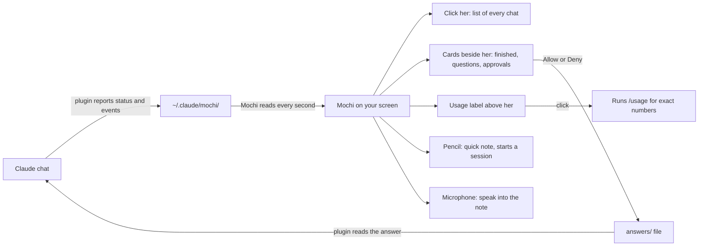

Mochi is built as a **mod** for Claude Code. A mod is a small TypeScript plugin that runs inside Claude Code and reacts to events, such as a chat finishing or a tool asking for approval. According to a [report from IT-Connect](https://www.it-connect.fr/claude-code-mods-plugins/), Anthropic announced mods on 1 October 2026, and they are enabled by default from Claude Code 2.1.287. That date comes from a single source, so check it against Anthropic's own documentation. Plugins, a related feature, were announced on [9 October 2025](https://anthropic.com/news/claude-code-plugins).

### Project layout

| Path | What it is |
| --- | --- |
| `pet-mod/` | The Claude Code plugin (TypeScript; its tests run with Bun). It reports what each chat is doing, and waits for her answer to an approval. Hooks are in `pet-mod/hooks/register.ts`. |
| `mochi-desktop/` | The macOS app that shows Mochi on your screen: one Swift file, `main.swift`, built with `build.sh`. |
| `mochi-studio/` | The macOS app for customising how Mochi looks (SwiftUI). |
| `media/` | Press and launch assets, and the screenshot renderer. See [media/README.md](media/README.md). |
| `docs/` | Images used in the docs. |
| `test.sh` | Runs every test and builds both apps. |

### What lives in `~/.claude/mochi/`

The plugin and the apps talk to each other only through plain files in this folder.

| File | What it holds |
| --- | --- |
| `sessions/<chat>.json` | The status and recent events each chat reports. The plugin writes it, Mochi reads it. |
| `answers/<chat>.json` | Your Allow or Deny, which the plugin picks up. |
| `presence.json` | Mochi tells the plugin she is here and which requests she is showing. The plugin waits for her answer only while she is. |
| `usage.json` | The newest plan-usage reading. |
| `days.json` | The daily counts behind This week and Diary, with no chat content. |
| `look.json` | Her look. Mochi Studio saves it, Mochi reads it. |
| `shortcuts.json` | Which global shortcuts macOS accepted (0 is accepted, anything else is an error code). |
| `mochi.log` | A log with times, so a failed step can be found afterwards. |

## Development

New work goes on the `dev` branch, with tests for each change. Every three days, `dev` is merged into `main` only if every test passes.

```sh
sh test.sh                        # all tests, then a build of both apps
sh mochi-desktop/build.sh         # builds mochi-desktop/Mochi.app
sh mochi-studio/build.sh          # builds mochi-studio/Mochi Studio.app
sh media/snapshots.sh             # redraws the README screenshots
```

`test.sh` runs the plugin's approval tests (`pet-mod/tests/approval.test.ts`, with Bun), Mochi Desktop's and Mochi Studio's logic tests (`mochi-desktop/tests/`, `mochi-studio/tests/`), and builds both apps. It ends with `ALL TESTS PASSED` when everything passes.

The desktop tests run against the real code: `test.sh` appends the test file to `main.swift`, cut just before the app starts. `media/snapshots.sh` uses the same trick to draw the real views with made-up data into `media/screenshots/`. Run it after you change how something looks, then commit the new images. It needs only the Xcode command line tools, and it reads nothing from `~/.claude/mochi`.

## Privacy

- Mochi reads and writes files only in `~/.claude/mochi/` and in the Claude app's own folders.
- Mochi's own code makes no network requests.
- The usage check runs the copy of Claude that comes with the app. That copy contacts Anthropic's servers to read your usage, the same way `/usage` does. Nothing is sent that you haven't already sent through Claude.

## Roadmap

- Real screen captures of Liquid Glass, the quick note box, and the right-click menu (the images above are drawn off screen)
- Sign and notarise the desktop app so it opens without warnings
- Support for Claude chats outside Claude Code

## Background

Claude didn't have a pet, so I made one for myself. I wanted a companion that lives alongside my work: one that tells me when things finish, asks for my attention when a chat needs me, and shows how much of my limit is left, without my having to watch every chat.

<details>
<summary>History: how Mochi grew</summary>

1. **A text pet in the side panel.** A small character with a status line, drawn with Claude Code's plugin system.
2. **A pet that walks.** It moved while Claude worked, and reacted when work finished or was blocked.
3. **A strip above the message box.** It moved out of the side panel, so it no longer took up space.
4. **Pixel art.** A 16×16 pixel cat with a status badge, later with a blinking, animated look.
5. **A floating app.** Mochi became her own small window that you can drag anywhere, with a list of every chat.
6. **Notification cards.** Finished work, questions, and approvals appear beside her as Liquid Glass cards that open their chat when clicked.
7. **Plan usage.** A label showing your 5-hour and weekly limits, and when you can continue.
8. **Skins.** Six looks to choose from.
9. **Mochi Studio.** A preview app for designing Mochi's look.
10. **Quick note and talk.** Two buttons under Mochi: type a note or speak it, and start a session with it.
11. **Allow or deny from Mochi, shortcuts, and undo.** Answer a chat's request from her card, open the note or talk from any app, and undo your painting in Mochi Studio.
12. **Jump, colours, and tidying.** A shortcut and badge click to reach the chat waiting for you, a colour dot for each chat, and old status files cleaned up.
13. **Quiet hour, and tidier files.** A right-click item that silences her for an hour, and old answer files cleaned up along with the status files.
14. **A clearer chat list and usage box.** Chats grouped by what they are doing, with the running and last finished session named at the top, larger text, and a usage box with bars and a Refresh button. Quiet can now last until you turn it off.

</details>

## Licence

MIT. See [LICENSE](LICENSE).
